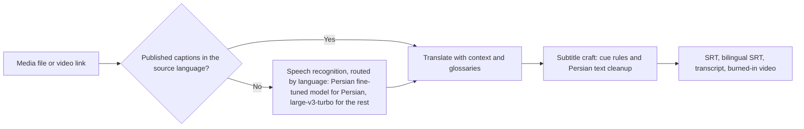

<div align="center">


**Send a file, or paste a video link, get Persian subtitles back.**

English | [فارسی](README.fa.md)

[](https://github.com/E30TZ/subfa/actions/workflows/ci.yml)
[](LICENSE)


</div>

SubFa turns a video or audio file into subtitles on your own machine:
a subtitle file in the target language (Persian by default), a
bilingual subtitle file, a plain transcript, and, for videos, a copy
with the subtitles burned in. No account, no uploads to strangers,
no per minute fees.

Demo (from the real smoke test in `smoke/SMOKE.md`: a synthetic
English speech clip, transcribed locally by Whisper tiny, burned in):


## Install from zero

One script, fetched straight from this repo, takes you from a
fresh machine (or a fresh Linux VPS) to a running SubFa. It
clones the project for you, checks Python 3.10+ and ffmpeg,
builds a virtual environment, and then asks, by number, which
surface you want: the Telegram bot, the web app, or the CLI.

**Linux, macOS, or a Linux VPS:**

```bash
curl -fsSL https://raw.githubusercontent.com/E30TZ/subfa/main/install.sh -o /tmp/subfa.sh && bash /tmp/subfa.sh install
```

Go straight to one surface by adding a target:

```bash
bash /tmp/subfa.sh install --target bot
bash /tmp/subfa.sh install --target web
bash /tmp/subfa.sh install --target cli
```

Flags can answer the wizard's questions up front; anything not
given is still asked. A fully scripted bot install looks like:

```bash
bash /tmp/subfa.sh install --target bot --token YOUR_TOKEN --admin-id 123456789 --no-models --run service
```

**Windows (PowerShell):**

```powershell
irm https://raw.githubusercontent.com/E30TZ/subfa/main/install.ps1 | iex
```

Cloning this repo and running
`powershell -ExecutionPolicy Bypass -File install.ps1` does the
same thing, and that form also takes the matching parameters
(`-Target`, `-Token`, `-AdminId`, `-Port`, `-Domain`, `-Ip`,
`-Models`, `-NoModels`, `-Run`, `-Lang`).

Already inside a checkout? `bash install.sh` or
`install.ps1` there runs the same wizard without cloning
anything. Every flag is documented in
[docs/INSTALL.md](docs/INSTALL.md).

What the wizard asks, per branch:

- **Bot:** your bot token from @BotFather (typed hidden, checked
  live against Telegram, never printed back), your numeric
  Telegram ID (stored in `.env` for your own use), whether to
  download the speech and translation models now, and how to run
  it: in this terminal, as a systemd service on Linux, or later
  by hand.
- **Web:** the port (default 8000), then domain or IP. With a
  domain on a Linux VPS it can also set up an nginx reverse proxy
  and a free Let's Encrypt HTTPS certificate. Without a domain it
  serves on the machine's IP and prints the address.
- **CLI:** installs the command, offers the model download, and
  prints real example commands.

The full manual path, mirroring the wizard step for step
(prerequisites per OS, extras per surface, `.env` keys, complete
systemd units, the nginx and certbot setup, updating and
uninstalling), is in [docs/INSTALL.md](docs/INSTALL.md).

## Try it

| Surface | How |
| --- | --- |
| Telegram bot | Run `BOT_TOKEN=your-token-from-botfather python -m bot.bot`, then send the bot a media file or a video link |
| Web page | Run `uvicorn web.app:app --host 0.0.0.0 --port 8000` and open the page |
| CLI | `subfa lecture.mp4 --target fa --burn -o out/` |

## What it does

- **Three ways in:** a Telegram bot, a small web page, and a CLI.
- **Two kinds of input:** upload a media file, or paste a link to a
  video page (YouTube and every other site yt-dlp supports).
- **Captions fast path:** if the video page already publishes
  subtitles or captions in the source language, SubFa uses them and
  skips speech recognition entirely. If they are missing or unusable,
  it falls back to Whisper automatically. The result always tells
  you which path was taken.
- **Local transcription with language-aware engines.** Stock
  Whisper is weak on Persian (published word error rates of
  20 to 56 percent), so Persian audio is routed to a Whisper model
  fine-tuned for Persian (`nezamisafa/whisper-persian-v4`, the top
  Persian model on the PESTE benchmark). Other languages use
  faster-whisper with `large-v3-turbo` and anti-hallucination
  decoding. Routing is automatic; the full decision record is in
  [docs/ASR.md](docs/ASR.md).

  Measured, not promised (Persian, FLEURS test set):

  | Engine | WER | Source |
  | --- | --- | --- |
  | nezamisafa/whisper-persian-v4 (SubFa default for fa) | 13.18% | PESTE benchmark |
  | Stock Whisper large-v3 | 20.37% | PESTE benchmark |
  | Stock Whisper small | 58.6% mean | Measured on this project's hardware, 3 clips ([smoke/ASR-BENCH.md](smoke/ASR-BENCH.md)) |
- **Offline translation** with Argos Translate. After a one time
  model download, translation works with no network at all.
- **Glossaries** fix technical terms: one JSON file per topic, applied
  after translation. Starters included: general, programming, gaming.
- **Outputs:** `name.fa.srt`, `name.bilingual.srt`,
  `name.transcript.txt`, and `name.subbed.mp4` for videos.



## After install: first run

The one-line installer above is the main way to install SubFa; if you used it, your environment is already set up. Prefer to install by hand? The manual path lives in [docs/INSTALL.md](docs/INSTALL.md).

### CLI

```bash
subfa lecture.mp4 --target fa --burn -o out/
subfa https://www.youtube.com/watch?v=VIDEO_ID --target fa --burn
subfa talk.mp3 --url https://example.com/talk --translator none
subfa lesson.mkv --glossary programming --bilingual -o out/
```

Run `subfa --help` for every option.

### Telegram bot

```bash
BOT_TOKEN=your-token-from-botfather python -m bot.bot
```

Send the bot a video, an audio file, a document, or paste a video
link. Pick the subtitle language with the buttons, and the bot sends
the subtitle files back and deletes its working copies.

Note: the public Telegram Bot API caps bot downloads at 20 MB and
uploads at 50 MB. Run a local Bot API server if you need larger
files. SubFa reports the effective cap instead of failing quietly.

### Web page

```bash
uvicorn web.app:app --host 0.0.0.0 --port 8000
```

Open the page, drop a file or paste a link, and download the results
when the job is done. Job files are deleted automatically one hour
after a job finishes.

### Docker

```bash
docker compose up web     # the web page on port 8000
docker compose up bot     # needs BOT_TOKEN in .env
```

Build with `--build-arg BUNDLE_MODELS=1` to download the speech
models into the image at build time, so the container never
downloads anything at runtime.

## Run on Windows, macOS, Linux

SubFa runs the same on all three systems. You need Python 3.10+
and ffmpeg on your PATH; only the install commands differ.

**1. Install ffmpeg**

- Windows: `winget install Gyan.FFmpeg` (or `choco install ffmpeg`,
  or the builds from ffmpeg.org)
- macOS: `brew install ffmpeg`
- Linux (Debian/Ubuntu): `sudo apt install ffmpeg`

**2. Create a virtual environment**

```bash
python -m venv .venv
```

Activate it: Windows (PowerShell) `.venv\Scripts\Activate.ps1`
or (cmd) `.venv\Scripts\activate.bat`; macOS and Linux
`source .venv/bin/activate`.

**3. Install and run, the same everywhere**

```bash
pip install -e ".[bot,web,translate]"
uvicorn web.app:app --host 0.0.0.0 --port 8000
```

Or use the launcher scripts, which create and reuse `.venv`,
install `requirements/web.txt`, and start the same web app:
`scripts\run-web.bat` on Windows, `./scripts/run-web.sh` on macOS
and Linux.

Notes: the model cache works the same on every system (set
`SUBFA_MODEL_CACHE` to move it), and the Docker path above is
unchanged on all three.

## Running fully offline (Iran friendly)

Speech and translation models are the only downloads SubFa ever
needs, and they are fetched once:

```bash
subfa download-models
```

This stores the faster-whisper model, the Persian fine-tuned
model and (when Argos is the translator) the Argos en/fa packages
in one cache folder (`SUBFA_MODEL_CACHE`, default
`~/.cache/subfa/models`). After that:

- Copy the folder to any machine, or keep it on the server.
- Run with `HF_HUB_OFFLINE=1` and no network at all. Transcription
  and translation are 100 percent local.

Mirrors: the downloads go through Hugging Face tooling, which
respects the `HF_ENDPOINT` environment variable. If the main hub
is slow or unreachable from your network, set `HF_ENDPOINT` to a
mirror before running `download-models`. The Docker build accepts
models bundled at build time (`BUNDLE_MODELS=1`, see above), which
is the most reliable option for servers in Iran: build once where
the network works, ship the image.

## Video links and your responsibility

Link downloading is powered by [yt-dlp](https://github.com/yt-dlp/yt-dlp).
Two honest limits apply, both configurable in `.env`:

- `SUBFA_MAX_DURATION_MIN` (default 60) and `SUBFA_MAX_DOWNLOAD_MB`
  (default 500). Downloads are also capped at 720p by default
  (`SUBFA_DOWNLOAD_MAX_HEIGHT`), because subtitling does not need 4K.
- Only download or subtitle content you have the right to use: your
  own uploads, public domain work, or material you have permission
  for. SubFa is a subtitling tool, not a way around anyone's rights.

For YouTube links, SubFa can also fetch the media through public
Invidious community instances, which proxy the video file at high
quality (1080p and up) from server IPs where YouTube itself gates
the direct download. The instance list is configurable with
`SUBFA_INVIDIOUS_INSTANCES`, and the route can be turned off with
`SUBFA_DISABLE_INVIDIOUS=1`. These are third-party community
servers: they can be slow or unavailable, and when every instance
fails, SubFa automatically falls back to the 360p route.

## Privacy

Files are processed locally, in a temporary folder, and deleted when
the job ends. Downloads from links are deleted with the job too.
Nothing is sent to a cloud transcription or translation service:
speech recognition runs on your machine and Argos Translate works
offline. The burned-in video is the only output that leaves the machine, and
only because you send or download it yourself.

## Quality features

Subtitles are a reading experience, and this is where toy tools
fail. SubFa treats these as rules with tests, not hopes:

- **Cue craft:** at most 42 characters per line and 2 lines per cue,
  a reading speed target of at most 20 characters per second, breaks
  at sentence ends first and clause ends second, and cues shorter
  than one second are merged instead of flashing.
- **Persian text cleanup:** Arabic Yeh and Kaf are normalized to
  Persian, ZWNJ (نیم‌فاصله) is applied to common patterns
  (می‌شود، کتاب‌ها، بزرگ‌تر), punctuation spacing and Persian quotes
  are fixed, and digits are rendered consistently (config:
  `SUBFA_DIGITS=fa|en|keep`).
- **Translation with context:** cues are translated in sliding
  windows of 10 with 2 context cues on each side, so pronouns and
  split sentences stay coherent. Glossaries apply after translation.
- **Style presets for burn-in:** `cinema` (bottom, large, strong
  outline), `reels` (vertical 9:16 safe area, bold, raised), and
  `learning` (bilingual, source line smaller above the translation).
  Pick with `--style` in the CLI, buttons in the bot, or the web form.
- **Web subtitle editor:** after a web job, open the edit page from
  the result, fix cue text and timing, save, and re-burn or
  re-download without re-transcribing.
- **Quality report per job:** every job writes a `report.txt` (and
  the bot and web page show the summary): cue count, percent of cues
  over the reading speed limit, transcript path taken (published
  captions or Whisper, with the model), and glossary terms applied.
  All numbers are computed from the actual cues.

## Persian subtitle styling

Burned-in subtitles use ASS styling through libass with the
**Vazirmatn** font by default. libass applies the Unicode bidi
algorithm, so Persian lines render right to left correctly. Install
Vazirmatn for the intended look (the Docker image tries to install
`fonts-vazirmatn`); without it, libass falls back to a system font
and subtitles still work with a plainer look. Set another font with
`SUBFA_FONT`. The web page uses Vazirmatn when available, with
system font fallbacks, which is good enough for v0.1.

## Glossaries

A glossary is one JSON file in `glossaries/`, mapping a term to the
exact translation the community wants:

```json
{ "programming": "برنامه‌نویسی", "bug": "باگ" }
```

Adding or improving a glossary is the easiest contribution to
SubFa: one file, no code. See [CONTRIBUTING.md](CONTRIBUTING.md).

## When SubFa is not the right tool

A note in the spirit of projects we admire: if a YouTube video
already has good subtitles and you only need the text, a plain
caption downloader is simpler. SubFa is built for making finished
Persian subtitle files (and a subtitled video) from files and
links, fully offline. It does not do live or real-time subtitling,
and Persian speech recognition needs roughly 6 GB of free RAM for
the fp16 model (an int8 conversion path is documented in
[docs/ASR.md](docs/ASR.md)). YouTube note: from datacenter IPs,
YouTube serves subtitle tracks but not the video file itself, so
link jobs from such hosts produce subtitle files only; send the
file itself for the burned-in version. Details in
[FAQ.fa.md](FAQ.fa.md).

## Built on

SubFa stands on excellent open source work: OpenAI Whisper and
the Persian fine-tune by nezamisafa, faster-whisper, Argos
Translate, yt-dlp, ffmpeg, and the Vazirmatn font by Saber
Rastikerdar. Thank you to every maintainer.

## Roadmap

- v0.1.0: file and link input, captions fast path, Persian and
  English subtitles, bilingual output, burn-in with style presets,
  glossaries, translation with context, web subtitle editor,
  quality report per job, bot, web page, CLI.
- Next: more target languages, speaker labels, a packaged desktop
  build, LLM based translation engines that use the context
  windows natively, and an experimental Parakeet engine
  (see docs/ASR.md for why it is not the default).

## License

MIT. See [LICENSE](LICENSE).
